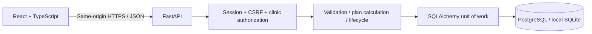
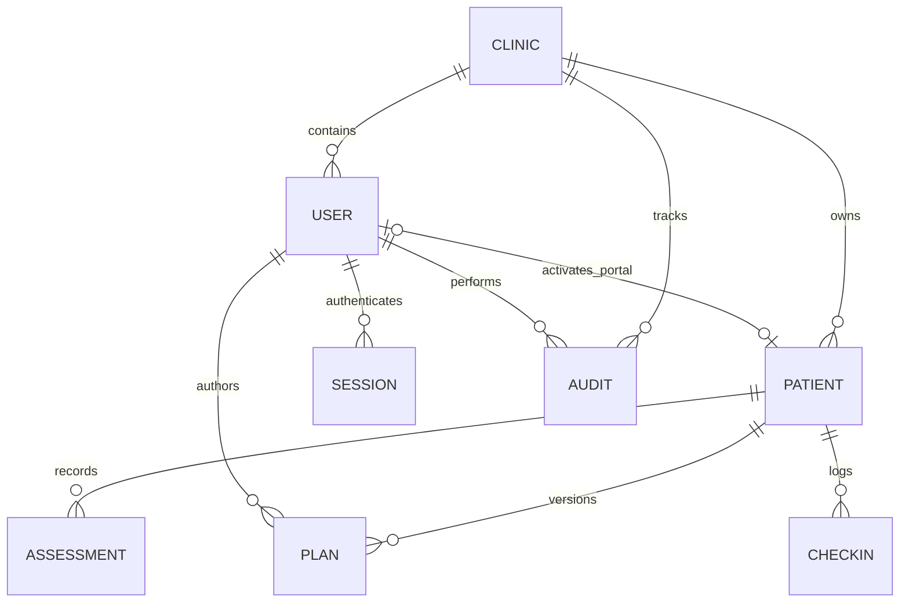
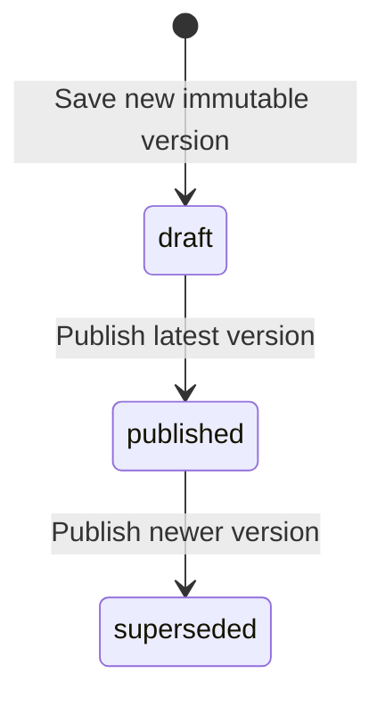

# Architecture and design decisions

## Request flow

A modular monolith keeps deployment and transactions straightforward. The project's strongest engineering concerns are ownership, consistency, and domain correctness. Splitting them into network services would add distributed coordination without demonstrated scale requirements.

## Data model

Food is a shared, read-only illustrative reference catalog. Plans store immutable snapshots of each food's name, properties, and scaled nutrition rather than deriving old plans from mutable reference records. Plan version uniqueness is enforced on `(patient_id, version)`. Daily check-in uniqueness is enforced on `(patient_id, day)`.

SQLite stores JSON and has limited concurrent writer capacity. PostgreSQL is the deployment target and supports row locking. API code uses the same SQLAlchemy models and versioned Alembic migrations for both.

## Authentication and authorization

Passwords are salted scrypt hashes. Session cookies contain 256-bit random bearer tokens; the database stores their SHA-256 hashes, CSRF secrets, user ownership, and 12-hour expiry. Logout deletes the session row, immediately invalidating that token. No browser localStorage contains an auth credential.

A public registration creates a new practice and dietitian account. This is self-service portfolio onboarding, not clinician credential verification. A patient cannot self-select a practice or elevate to dietitian. A dietitian issues a 48-hour random invitation token, stored hashed and bound to the patient's recorded email. Activation clears the invitation and links the account.

Every patient operation resolves ownership centrally. A dietitian can access patients only in their clinic. A patient can access only their own linked profile. Unauthorized object identifiers return 404. Dietitian-only routes also check role. Dashboard queries and audit events are clinic-scoped. Patient API responses filter plans to currently published versions.

Mutations require the session's CSRF secret in a custom header and reject unapproved Origin headers. Cookies are HttpOnly/SameSite and Secure when deployed with `COOKIE_SECURE=true`. Same-origin hosting avoids third-party cookie dependencies. The browser's API cache is disabled. A CSP limits the application bundle to same-origin resources, with a dedicated CDN allowance only for FastAPI's interactive documentation.

The auth attempt limiter is intentionally one-process memory state; it is not claimed as distributed abuse prevention. Expired session cleanup occurs on successful login. Password reset and MFA are pending features.

## Plan lifecycle and concurrency

The client sends the highest version it read. A stale version yields 409 and requires reload. PostgreSQL locks the patient row during plan save/publication, serializing competing writes. A unique constraint also prevents duplicate version insertion and maps that conflict to 409. SQLite's uniqueness protection remains useful, but high-write-concurrency behavior has not been stress-tested.

The nutrition service fetches referenced foods in a batch, validates recorded allergen conflicts, scales nutrients by `grams / reference_unit`, rounds line values to two decimals, and sums those line values. The server ignores client nutrition totals. Draft publication rechecks current recorded allergies, so newly recorded allergies can block a previously saved draft. Audit changes commit in the same transaction as the domain action.

A superseded published plan remains visible to the dietitian for export. Patients see only the current published plan. This release intentionally offers no mutation of an existing plan's items or deletion of historical versions.

## Observability and scope

Every response carries a request ID; request logs record method, path, status, and request ID without bodies or cookies. Audit events record actor, clinic, resource identifier, action, and UTC timestamp. `/api/health` checks DB connectivity. UTC timestamps are explicit even with SQLite; the frontend renders local dates.

No scale, latency, availability, or security-compliance claims are made without measurements. CI includes an isolated PostgreSQL job, and future work should add load tests, concurrent save tests, operational dashboards, and deployment smoke tests.
